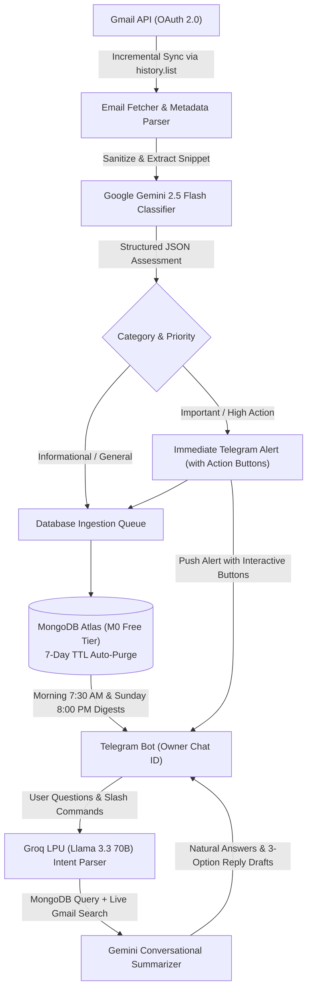

# 📬 AI Email Assistant — Autonomous Personal Intelligence Engine

<p align="center">
  
  
  
  
  
  
  
</p>

An autonomous personal AI Email Intelligence Assistant that continuously monitors your Gmail inbox, classifies emails with **Google Gemini 2.5 Flash & Groq LPU (Llama 3.3 70B)**, sends smart **Telegram Digests & Alerts**, tracks **Campus Placement/TPO Notices**, generates **1-Tap AI Reply Drafts**, and answers natural language questions conversationally — **100% within free-tier cloud limits at ₹0/month**.

---

## 📑 Table of Contents
- [✨ Key Superpowers](#-key-superpowers)
- [🏛️ System Architecture](#️-system-architecture)
- [🤖 Interactive Telegram Experience](#-interactive-telegram-experience)
- [📋 Slash Commands & Natural Language](#-slash-commands--natural-language)
- [💰 Zero-Cost Quota Analysis](#-zero-cost-quota-analysis)
- [📁 Project Structure](#-project-structure)
- [🚀 Quickstart & Local Setup](#-quickstart--local-setup)
- [🌐 24/7 Render Cloud Deployment](#-247-render-cloud-deployment)
- [🔒 Security & Privacy Guarantees](#-security--privacy-guarantees)

---

## ✨ Key Superpowers

* **📬 Daily Morning Digest (7:30 AM IST):** A structured, executive summary of all incoming communications, priority categorization, action items, and due dates delivered right to your phone.
* **🚨 Real-Time Important & Urgent Action Alerts:** Immediate push notifications for critical security alerts, high-priority matters, and urgent action items.
* **🔘 Interactive Inline Action Buttons:** Every Telegram alert includes direct interactive buttons:
  * `[ 🔗 Open in Gmail ]` — Deep-links directly to the exact email thread in Gmail.
  * `[ ✅ Mark Done ]` — Instantly marks pending tasks resolved in MongoDB with 1 tap.
  * `[ ✍️ Draft Quick Reply ]` — Triggers Gemini to draft 3 tailored response options.
* **✍️ 1-Tap AI Reply Drafter (`/reply`):** Automatically drafts 3 distinct, professional email replies (Acceptance, Request Details, Polite Decline) formatted in monospace tap-to-copy code blocks.
* **🎓 Campus & Placement Drive Tracker (`/placements`):** Intelligent entity resolution for **Vignan's Lara Institute of Technology and Science (VLITS / TPO)** notices, internship drives, eligibility criteria, and deadlines.
* **🌙 Smart Night Mode (DND Window):** Silences non-urgent alerts between **11:00 PM and 7:00 AM IST**, cleanly bundling them into your 7:30 AM Morning Digest.
* **📊 Weekly Executive Retrospective (`/weekly`):** Retrospective delivered every **Sunday at 8:00 PM IST** analyzing 7-day volume, completed tasks, and upcoming deadlines.
* **⚡ Sub-Second Intent Routing with Groq LPU:** Natural conversational chat powered by Llama 3.3 70B with automatic fallback to Gemini.
* **🔒 Privacy-First Zero-Body Storage:** Stores only metadata & snippets in MongoDB with an automatic **7-Day TTL (Time-To-Live)**. Original Gmail emails are never altered or deleted (`gmail.readonly`).

---

## 🏛️ System Architecture



---

## 🤖 Interactive Telegram Experience

### 1. Real-Time Important Email Alerts
```text
🚨 Important Email Alert

👤 From: Training & Placement Officer (VLITS)
📌 Subject: TCS Digital Campus Recruitment Drive — Registration Link
🕒 Received: 10:45 AM IST

📝 AI Summary:
Registration is open for TCS Digital campus drive for final year B.Tech students. Mandatory registration required before deadline.

⚡ Action Needed: Fill out the application form
⏰ Deadline: 2026-10-10

[ 🔗 Open in Gmail ]   [ ✅ Mark Done ]
[ ✍️ Draft Quick Reply ]
```

### 2. 1-Tap AI Reply Drafter (`/reply`)
```text
📬 AI Reply Suggestions for: "TCS Digital Campus Recruitment Drive"
To: TPO Vignan

━━━━━━━━━━━━━━━━━━━━━
Option 1: Quick Acceptance / Confirmation
```text
Dear TPO Team,

Thank you for sharing the details regarding the TCS Digital drive. I have successfully submitted my registration form along with the required documents.

Best regards,
[Your Name]
```

━━━━━━━━━━━━━━━━━━━━━
Option 2: Acknowledgement / Request Details
```text
Dear Sir/Madam,

Thank you for the update. Could you please clarify if students with an active backlog are eligible to apply for this drive?

Best regards,
[Your Name]
```
💡 Tap any block to copy, then paste directly into Gmail!
```

---

## 📋 Slash Commands & Natural Language

### 🎮 Available Slash Commands
| Command | Description | What It Does |
| :--- | :--- | :--- |
| **`/today`** | Today's Overview | Displays a breakdown and count of all emails received today. |
| **`/important`** | High-Priority Mails | Lists all flagged critical communications from the last 7 days. |
| **`/actions`** | Pending Action Items | Shows all active emails requiring a reply, submission, or payment. |
| **`/done <keyword>`** | Resolve Action Item | Marks matching task resolved in MongoDB (e.g. `/done Amazon` or `/done TCS`). |
| **`/reply <keyword>`** | Draft AI Replies | Generates 3 professional response options for any matching email. |
| **`/placements`** | Campus / TPO Tracker | Aggregates campus recruitment circulars, deadlines, and drive links. |
| **`/weekly`** | 7-Day Retrospective | Comprehensive review of processed volume, completed items, and upcoming dates. |
| **`/summary`** | Inbox Stats | Statistical overview across important, action, and informational categories. |
| **`/sync`** | Manual Refresh | Forces an instant live sync of recent Gmail messages. |
| **`/help`** | Help Menu | Comprehensive command reference and guide. |

### 💬 Natural Language Questions You Can Ask
You don't need strict syntax! Just type naturally:
* *"Did my college or TPO send any emails today?"*
* *"What deadlines do I have approaching this week?"*
* *"Did I receive an invoice or receipt from Amazon?"*
* *"Show me emails that require my immediate reply"*
* *"Summarize all updates from professors today"*

---

## 💰 Zero-Cost Quota Analysis

Designed specifically for **100+ emails/day** with massive headroom on free tiers:

| Provider | Metric | Free Tier Daily Limit | App Daily Usage | Headroom % |
| :--- | :--- | :--- | :--- | :--- |
| **Gmail API** | Quota Units | **1,000,000 units/day** | ~600 units/day | **99.94% Free** 🟢 |
| **Google Gemini API** | AI Calls | **1,500 requests/day** | ~125 requests/day | **91.70% Free** 🟢 |
| **Groq Cloud** | Intent Parsing | **14,400 requests/day** | ~30 requests/day | **99.79% Free** 🟢 |
| **Telegram API** | Bot Messages | **Unlimited** | ~35–50 msgs/day | **100% Free** 🟢 |
| **MongoDB Atlas** | Storage | **512 MB Storage** | ~3.1 MB (with 7-Day TTL) | **99.40% Free** 🟢 |

---

## 📁 Project Structure

```text
EmailAutomation/
├── scripts/
│   └── check-build.js               # 22-point automated build & security test suite
├── src/
│   ├── config/
│   │   ├── database.js              # MongoDB Atlas connection lifecycle
│   │   └── env.js                   # Strict environment variable validator
│   ├── controllers/
│   │   ├── authController.js        # Google OAuth2 authorization & token display
│   │   ├── callbackHandler.js       # Telegram inline button handler ([Done], [Reply])
│   │   ├── commandHandler.js        # Slash command router (/today, /actions, /placements, etc.)
│   │   ├── intentHandler.js         # Natural language conversational controller
│   │   ├── jobController.js         # Scheduled HTTP cron endpoints with secret auth
│   │   └── webhookController.js     # Fast-ack Telegram webhook router
│   ├── integrations/
│   │   ├── gemini/
│   │   │   ├── client.js            # Gemini SDK client with stable fallback cascade
│   │   │   ├── classifier.js        # AI classification with prompt injection defense
│   │   │   ├── intentParser.js      # Gemini fallback intent extraction engine
│   │   │   └── summarizer.js        # Conversational answer & digest synthesis
│   │   ├── gmail/
│   │   │   ├── auth.js              # OAuth2 consent URL & token exchange
│   │   │   ├── client.js            # Authenticated Google OAuth client
│   │   │   ├── fetcher.js           # Search, fetch, and paginated history.list operations
│   │   │   └── parser.js            # Zero-payload attachment name & metadata parser
│   │   ├── groq/
│   │   │   ├── client.js            # Groq LPU SDK client
│   │   │   └── intentParser.js      # Sub-second Llama 3.3 70B intent parser with College rules
│   │   └── telegram/
│   │       ├── client.js            # Telegram Bot API client & setMyCommands menu
│   │       ├── formatter.js         # Alert templates, inline keyboards & digest formats
│   │       ├── polling.js           # Local dev long-poller (no ngrok required)
│   │       └── sender.js            # Telegram dispatcher with auto 4096-char chunking
│   ├── jobs/
│   │   ├── digestJob.js             # Morning digest job handler
│   │   ├── pollJob.js               # Incremental email polling job handler
│   │   └── scheduler.js             # Internal timer scheduler (Hourly, 7:30 AM, Sunday 8 PM)
│   ├── middleware/
│   │   ├── errorHandler.js          # Global centralized error handler
│   │   ├── validateJobSecret.js     # X-Job-Secret header authenticator
│   │   └── validateWebhook.js       # Telegram secret & chat ID whitelist firewall
│   ├── models/
│   │   ├── DigestLog.js             # Idempotency digest log (7-Day TTL)
│   │   ├── Email.js                 # Structured email schema (7-Day TTL index)
│   │   └── GmailState.js            # Incremental historyId pointer & bot statistics
│   ├── routes/
│   │   ├── auth.js                  # /auth/google, /auth/google/callback
│   │   ├── health.js                # GET /health (zero-cost keep-alive)
│   │   ├── jobs.js                  # /jobs/digest, /jobs/poll-emails
│   │   └── webhook.js               # POST /webhook/telegram
│   ├── services/
│   │   ├── digestService.js         # Morning digest compiler with idempotency
│   │   ├── emailProcessor.js        # Batch ingestion, classification, and urgent alerts
│   │   ├── notificationService.js   # Immediate alert dispatcher with DND window check
│   │   ├── placementService.js      # Campus recruitment & TPO notices aggregator
│   │   ├── queryService.js          # Dual-layer query engine (MongoDB + Gmail fallback)
│   │   ├── replyService.js          # 3-option AI quick reply generator
│   │   └── weeklyService.js         # 7-day retrospective & deadline compiler
│   ├── utils/
│   │   ├── dateHelpers.js           # IST timezone, formatters & isDndActive()
│   │   ├── logger.js                # Pino structured logging with token redaction
│   │   ├── retry.js                 # Exponential backoff with jitter
│   │   └── textHelpers.js           # HTML strip, sanitization & truncate utilities
│   ├── app.js                       # Express app configuration & middleware
│   └── server.js                    # Server startup & shutdown lifecycle
├── .env.example
├── .gitignore
├── package.json
└── README.md
```

---

## 🚀 Quickstart & Local Setup

### 1. Prerequisites
- **Node.js (v18+)**
- **MongoDB Atlas Free Cluster (M0)**
- **Google Cloud Console Project** (with Gmail API enabled)
- **Gemini API Key** (from [Google AI Studio](https://aistudio.google.com/))
- **Groq API Key** (from [Groq Console](https://console.groq.com/))
- **Telegram Bot Token** (from `@BotFather` on Telegram)

### 2. Environment Configuration
Copy `.env.example` to `.env`:
```bash
cp .env.example .env
```

Configure your variables:
```env
PORT=3000
NODE_ENV=development

# Google OAuth2 Credentials
GOOGLE_CLIENT_ID=your_client_id.apps.googleusercontent.com
GOOGLE_CLIENT_SECRET=your_client_secret
GOOGLE_REDIRECT_URI=http://localhost:3000/auth/google/callback
GMAIL_REFRESH_TOKEN=

# AI Engine Keys
GEMINI_API_KEY=your_gemini_api_key
GROQ_API_KEY=your_groq_api_key

# Telegram Bot
TELEGRAM_BOT_TOKEN=your_bot_token
TELEGRAM_CHAT_ID=your_numeric_chat_id
TELEGRAM_WEBHOOK_SECRET=your_random_secret_token

# MongoDB Atlas
MONGODB_URI=mongodb+srv://<user>:<password>@cluster0.mongodb.net/ai_email_assistant?retryWrites=true&w=majority

# Security Secret
JOB_SECRET=your_random_32_character_job_secret
```

### 3. Install & Verify
```bash
# 1. Install dependencies
npm install

# 2. Run automated test suite
npm run check

# 3. Start local development server (includes Telegram dev polling)
npm run dev
```

### 4. Authorize Gmail (One-Time)
1. Open your browser and navigate to `http://localhost:3000/auth/google`.
2. Sign in with your Gmail account and grant read-only access.
3. On the confirmation screen, copy the generated `GMAIL_REFRESH_TOKEN`.
4. Paste it into your `.env` file as `GMAIL_REFRESH_TOKEN=...` and restart the server.

---

## 🌐 24/7 Render Cloud Deployment

### 1. Deploy on Render
1. Create a **New Web Service** on [Render](https://render.com) connected to your GitHub repository.
2. Settings:
   * **Runtime:** `Node`
   * **Build Command:** `npm install`
   * **Start Command:** `node src/server.js`
3. Add all environment variables from your `.env` to the Render Dashboard (Set `GOOGLE_REDIRECT_URI=https://<your-app>.onrender.com/auth/google/callback` and `NODE_ENV=production`).

### 2. Register Telegram Webhook
Run this command in your terminal to link Telegram to your Render URL:
```bash
curl -X POST "https://api.telegram.org/bot<TELEGRAM_BOT_TOKEN>/setWebhook" \
  -d "url=https://<your-app>.onrender.com/webhook/telegram" \
  -d "secret_token=<TELEGRAM_WEBHOOK_SECRET>"
```

### 3. Configure Free Schedulers on [cron-job.org](https://cron-job.org)
*(Set Timezone to **Asia/Kolkata**)*

| Job Name | Schedule | Target URL | Custom Headers |
| :--- | :--- | :--- | :--- |
| **Render Keep-Alive** | `*/10 * * * *` (Every 10 min) | `https://<your-app>.onrender.com/health` | *(None)* |
| **Morning Digest** | `30 7 * * *` (Daily 7:30 AM IST) | `https://<your-app>.onrender.com/jobs/digest` | `X-Job-Secret: <JOB_SECRET>` |
| **Email Poll** | `0 * * * *` (Hourly) | `https://<your-app>.onrender.com/jobs/poll-emails` | `X-Job-Secret: <JOB_SECRET>` |

---

## 🔒 Security & Privacy Guarantees

* 🛡️ **Read-Only Scope (`gmail.readonly`):** The bot has no permission to delete, modify, or send emails on your behalf.
* 🛡️ **Zero-Exposure Firewall:** The Telegram webhook strictly ignores and rejects any incoming messages that do not match your authenticated `TELEGRAM_CHAT_ID`.
* 🛡️ **Protected Cron Endpoints:** `/jobs/*` endpoints reject any request lacking the valid `X-Job-Secret` header with `403 Forbidden`.
* 🛡️ **7-Day Auto-Purge:** MongoDB uses native TTL indexes (`expireAfterSeconds: 0`) to automatically purge email records after 7 days.
* 🛡️ **Prompt Injection Defenses:** AI system prompts isolate email content as untrusted data, enforcing strict JSON output schemas.
* 🛡️ **Token Redaction:** Passwords, OAuth tokens, and sensitive HTTP headers are automatically censored in all server logs.

---

<p align="center">
  Built with ❤️ for intelligent, stress-free email productivity.
</p>
